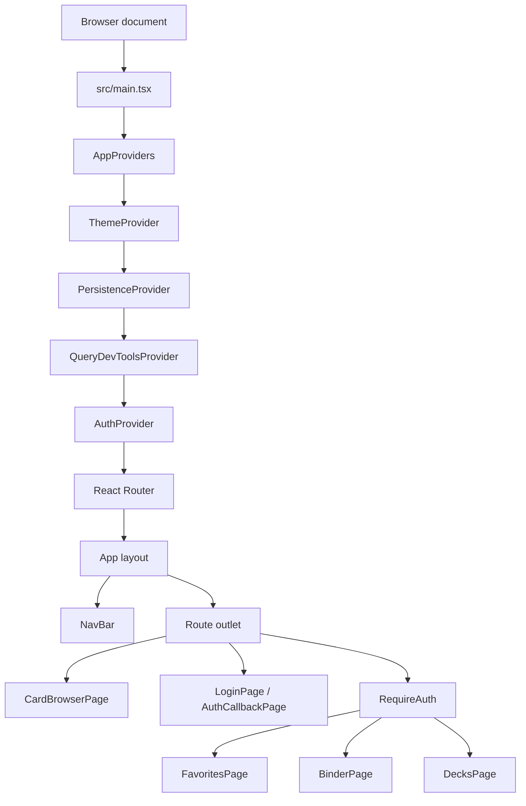

# Application architecture

This guide describes the live V2 application. The source code is authoritative;
update this guide when route ownership or feature boundaries change.

## Application composition

`src/main.tsx` mounts the providers under React `StrictMode`. The provider tree
shares theme, persisted TanStack Query state, authentication, and routing with
the route components. `App` in `src/app/App.tsx` owns the V2 navigation shell;
route content renders in its outlet.

## Route map

The route definitions live in [`src/app/router.tsx`](../../src/app/router.tsx).

| Route | Owner | Access and behavior |
|---|---|---|
| `/` | Router loader | Redirects to `/v2/home`. |
| `/v2` | Router loader | Redirects to `/v2/home`. |
| `/v2/home` | `Home` → `CardBrowserPage` | Daily seven-card mulligan. |
| `/v2/search` | `CardBrowserPage` | Name search; URL parameters carry query, scope, filters, and optional card overlay. |
| `/v2/search/random` | `CardBrowserPage` | Daily mulligan browser. |
| `/v2/search/advanced` | `AdvancedSearch` | Placeholder, not an implemented advanced-search feature. |
| `/v2/login` | `LoginPage` | Email/password authentication. |
| `/v2/auth/callback` | `AuthCallbackPage` | Completes the Supabase auth callback and returns to a safe V2 URL. |
| `/v2/collection` | Router redirect | Compatibility path to `/v2/binder`. |
| `/v2/favorites` | `FavoritesPage` | Sign-in required. |
| `/v2/binder` | `BinderPage` | Sign-in required; binder folders, owned copies, and loose copies. |
| `/v2/decks` | `DecksPage` | Sign-in required; deck management and card entries. |

`NuqsAdapter` is mounted inside the router layout so feature components can
read/write URL-backed filter state.

## Feature boundaries

| Area | Responsibility |
|---|---|
| `src/app/` | Application entry components, providers, route tree, and V2 shell. |
| `src/features/auth/` | Login, callback, protected-route guard, and safe auth redirects. |
| `src/features/card-browser/` | Scryfall search/mulligan orchestration, card tiles, card details, and card-browser data contracts. |
| `src/features/card-filters/` | URL parsers, TanStack Table configuration, filter controls, and filter-category labels. |
| `src/features/favorites/` | User-scoped favorite queries/mutations, a shared card favorite-action hook, and the favorites page. |
| `src/features/binder/` | Binder folders, per-copy metadata, disposal/history, and Binder page. |
| `src/features/decks/` | Deck and deck-entry queries/mutations, entry popover, and Decks page. |
| `src/features/navigation/` | Responsive navigation, theme/search controls, and route-aware search behavior. |
| `src/features/scryfall-card-renderer/` | Shared renderer for normalized Scryfall card layouts and Oracle text. |
| `src/assets/icons/` | Reusable React SVG components. Site branding SVGs remain under `public/`. |
| `src/hooks/` | Cross-feature React hooks such as cached URL fetches, scroll visibility, and Realtime invalidation. |
| `src/services/` | Scryfall API helpers, Supabase client, and Realtime mutation-echo tracking. |
| `src/types/` | Generated Supabase database types. |

### Rendering and data flow

The card browser owns the page-level coordination. The custom
[`useCardBrowserResults`](../../src/features/card-browser/useCardBrowserResults.ts)
hook interprets the URL and chooses between the Scryfall search, personal
collection, or daily mulligan data sources. `CardFilters` sorts and filters
loaded cards; `CardTile` renders each card; `CardDetailsOverlay` renders card
details and printings. Binder and Decks reuse the tile and details overlay
instead of maintaining separate card renderers.

Raw API records are validated at feature boundaries. The shared renderer
normalizes records before its layout-specific components render them. This
keeps API response handling separate from presentation.

## Reading order for maintainers

1. Start at [`src/main.tsx`](../../src/main.tsx), then
   [`src/app/AppProviders.tsx`](../../src/app/AppProviders.tsx).
2. Read [`src/app/router.tsx`](../../src/app/router.tsx) for URL ownership.
3. Read the page component for the feature being changed.
4. Follow feature-owned hooks before shared hooks and services.
5. Use [`state-and-data.md`](./state-and-data.md) for URL, cache, auth, and
   Supabase state relationships.
6. Use [`code-reference.md`](./code-reference.md) for a file-by-file inventory
   of source responsibilities and exported contracts.
