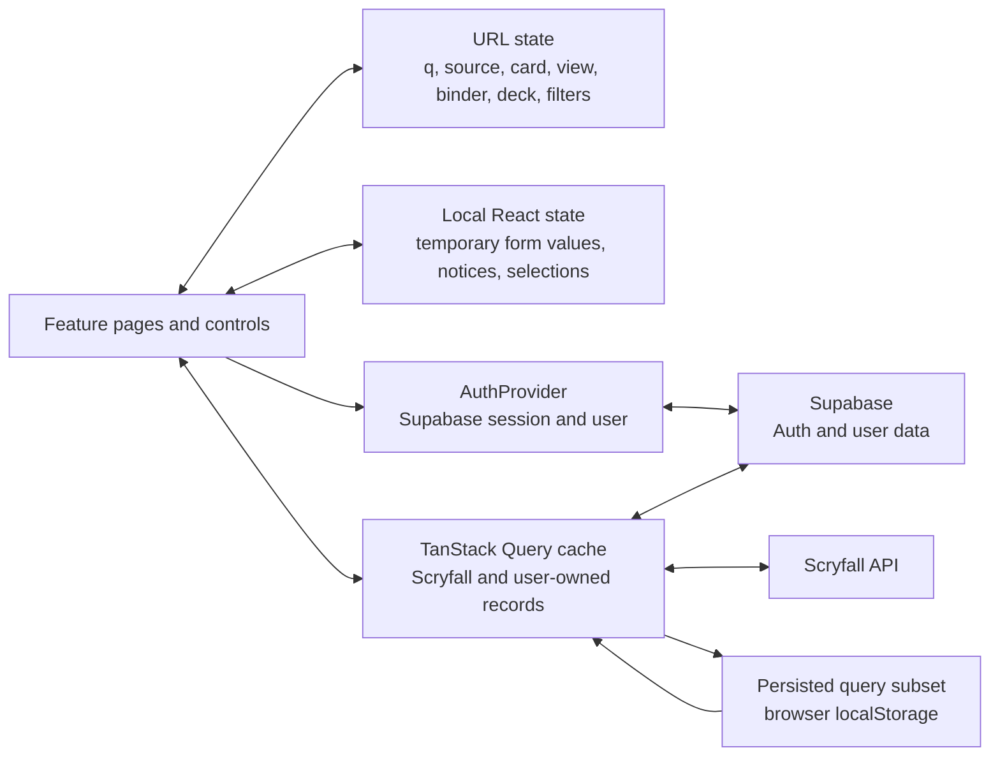
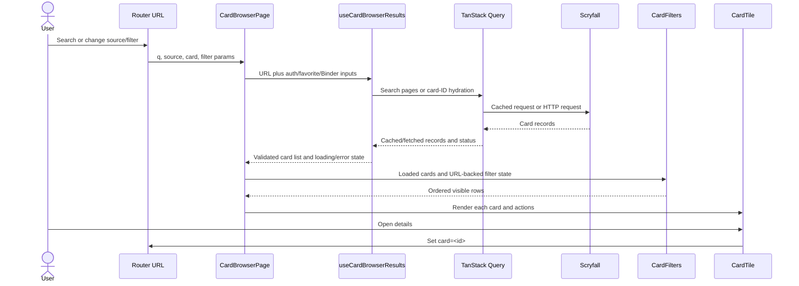
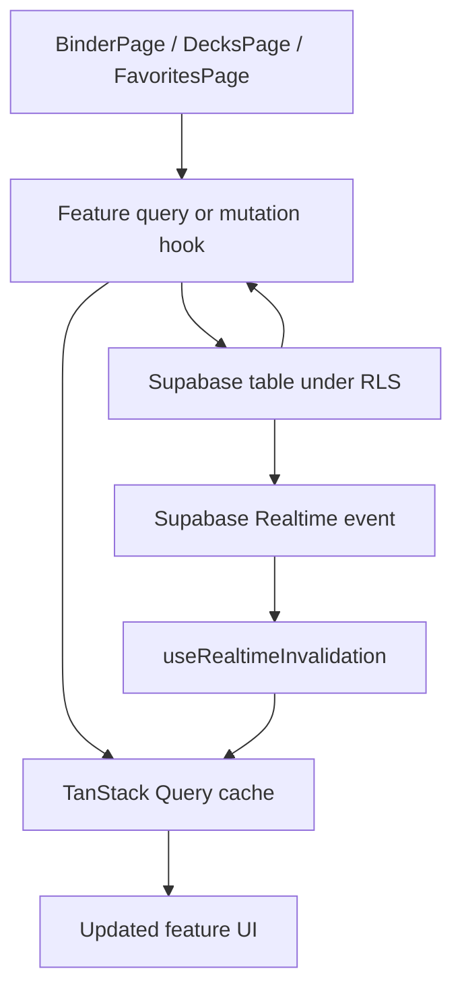

# State and data flows

This document explains where application state lives and how card data moves
through the V2 application. See [the architecture overview](./overview.md) for
routes and component ownership.

## State ownership

| State kind | Examples | Owner / source of truth |
|---|---|---|
| URL state | Search term `q`, search scope `source`, selected card `card`, Binder/Deck view and selection, card filters | React Router search params and `nuqs` parsers. It is shareable and survives reloads. |
| Local component state | Notice text, unsaved form values, selected cards for a bulk move, current overlay presentation | The page or component that owns the interaction. It is not persisted unless represented in the URL. |
| Authentication | Supabase session and current user | `AuthProvider`; user-specific queries are enabled/scoped by the authenticated user. |
| Remote/cache state | Scryfall search pages, card details, Binder/favorites/decks query results | TanStack Query, with query keys including relevant identifiers and request parameters. |
| Persisted query state | Selected Scryfall search and auxiliary URL query data | `PersistenceProvider` and browser `localStorage`; not all queries are persisted. |
| Database state | Favorites, Binder folders/copies, decks/entries | Supabase under row-level security. Realtime events invalidate caches; payloads are not treated as trusted application data. |

## Card browser search flow

The search hooks preserve separate query keys for a paginated name search and a
single-page daily mulligan. The daily set is stable for the UTC day; changing
the day changes the query seed. Collection search hydrates deduplicated IDs
from favorites and owned Binder copies. Disposed Binder copies are excluded.
Search filters operate on loaded cards; they are not sent as an advanced
Scryfall query.

## User-owned data and mutations

Mutations patch their relevant cache where implemented. Realtime is an
invalidation signal, after which the normal user-scoped query reads the
authoritative row under RLS. Locally-originated Realtime echoes are tracked by
`src/services/localRealtimeChanges.ts` so they do not undo a local cache patch.

## Interaction invariants

- Keep URL-backed state in the existing query parameters; do not shadow it with
  independent state unless a component needs an uncommitted draft.
- Preserve user scoping in query keys and Supabase queries.
- Treat Scryfall and Supabase responses as external data; validate shapes before
  rendering or using them to build mutations.
- Keep Scryfall requests bounded and paced. Collection hydration is limited to
  75 identifiers per request.
- Use Realtime events to invalidate/refetch, not as trusted replacement rows.
- Prices are current Scryfall prices, not price history or collection valuation.

